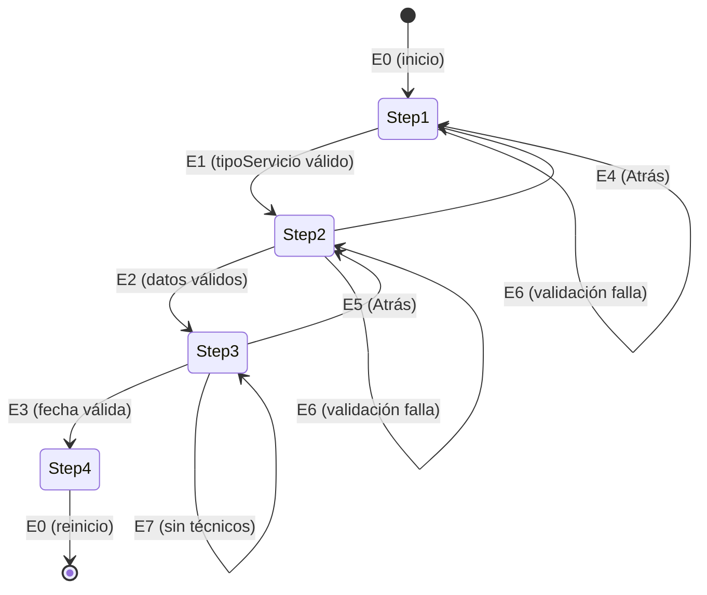

# Parte 1 — Pruebas de Caja Negra (Frontend)

**Proyecto:** RepairTech — Frontend React
**Componentes:** RegistroModal, LoginModal, AgendarCita
**Tecnología:** React 19 + React Testing Library + Jest
**Fecha:** 2026-09-20

---

## 1.0 Variables de entrada seleccionadas

Se seleccionaron **dos variables** del componente `RegistroModal` ([RegistroModal.jsx](../../src/components/RegistroModal.jsx)) con sus expresiones de validación reales en el código.

| # | Variable | Componente | Sentencia de validación |
|---|----------|------------|------------------------|
| **V1** | `password` | RegistroModal | `formData.password.length < 6` |
| **V2** | `telefono` | RegistroModal | `formData.phone.length < 10` |

Variables de apoyo adicionales:

| Variable | Componente | Expresión |
|----------|------------|-----------|
| `email` | RegistroModal | `validarEmail(formData.email)` → `/^[^\s@]+@[^\s@]+\.[^\s@]+$/` |
| `docNumber` | RegistroModal | `formData.docNumber.length < 6` |
| `fullName` | RegistroModal | `formData.fullName.length < 3` |
| `descripcion` | AgendarCita | `formData.descripcion.trim().length < 10` |
| `fecha` | AgendarCita | `step === 3 && !formData.fecha` |

---

## 1.1 Partición de Equivalencia

### Clases de equivalencia — V1: `password`

| Clase | Descripción | Tipo | Representante | Salida esperada |
|-------|-------------|------|---------------|-----------------|
| **CE1** | Cadena vacía o ausente | Inválida | `""` | "La contraseña es requerida" |
| **CE2** | 1 a 5 caracteres | Inválida | `"12345"` | "La contraseña debe tener al menos 6 caracteres" |
| **CE3** | 6 o más caracteres | **Válida** | `"Clave123"` | Pasa validación |
| **CE9** | Tipo no string (número, booleano) | Inválida | `12345` | Comportamiento indefinido (no se valida tipo) |

### Clases de equivalencia — V2: `telefono`

| Clase | Descripción | Tipo | Representante | Salida esperada |
|-------|-------------|------|---------------|-----------------|
| **CE4** | Ausente o vacío | Inválida | `""` | "El teléfono es requerido" |
| **CE5** | 1 a 9 dígitos | Inválida | `"300123456"` | "El teléfono debe tener 10 dígitos" |
| **CE6** | Exactamente 10 dígitos | **Válida** | `"3001234567"` | Pasa validación |
| **CE7** | 11 o más dígitos | Inválida | `"30012345678"` | Comportamiento (maxLength="10" lo corta) |
| **CE8** | Caracteres no numéricos | Inválida | `"300-ABC-456"` | El input `type="tel"` + `replace(/\D/g,'')` normaliza a números |

### Casos de prueba — Partición de equivalencia

| ID | Clase | Variable | Entrada | Resultado esperado |
|----|-------|----------|---------|-------------------|
| CP-EQ01 | CE1 | `password` | `password: ""` | mensaje "La contraseña es requerida" |
| CP-EQ02 | CE2 | `password` | `password: "12345"` | mensaje "al menos 6 caracteres" |
| CP-EQ03 | CE3 | `password` | `password: "Clave123"` | Sin mensaje de error de password |
| CP-EQ04 | CE4 | `telefono` | `phone: ""` | mensaje "El teléfono es requerido" |
| CP-EQ05 | CE5 | `telefono` | `phone: "300123456"` (9 dígitos) | mensaje "10 dígitos" |
| CP-EQ06 | CE6 | `telefono` | `phone: "3001234567"` | Sin mensaje de error de teléfono |
| CP-EQ07 | CE7 | `telefono` | `phone: "30012345678"` (11) | Input lo corta a 10 por maxLength |
| CP-EQ08 | CE8 | `telefono` | `phone: "300-ABC-4567"` | Se normaliza a `"300ABC4567"` → 10 dígitos válidos |

---

## 1.2 Análisis de Valores Límite

### V1: `password.length` — frontera en 6

Expresión: `formData.password.length < 6`

| ID | Tipo de valor | Longitud | Entrada | Resultado esperado |
|----|---------------|----------|---------|-------------------|
| CP-VL01 | Límite inferior externo | 0 | `""` | "La contraseña es requerida" |
| CP-VL02 | Límite − 1 | 5 | `"aaaaa"` | "al menos 6 caracteres" |
| CP-VL03 | **Límite (frontera)** | 6 | `"aaaaaa"` | Pasa validación |
| CP-VL04 | Límite + 1 | 7 | `"aaaaaaa"` | Pasa validación |
| CP-VL05 | Límite superior arbitrario | 64 | `"a".repeat(64)` | Pasa validación |

### V2: `telefono.length` — frontera en 10

Expresión: `formData.phone.length < 10`

| ID | Tipo de valor | Dígitos | Entrada | Resultado esperado |
|----|---------------|---------|---------|-------------------|
| CP-VL06 | Inferior − 1 | 9 | `"300123456"` | "El teléfono debe tener 10 dígitos" |
| CP-VL07 | **Límite inferior** | 10 | `"3001234567"` | Pasa validación |
| CP-VL08 | Inferior + 1 | 11 | `"30012345678"` | Input lo corta a 10 → pasa |
| CP-VL09 | Límite externo (9 dígitos) | 9 | `"300123456"` | Error |
| CP-VL10 | Límite externo (1 dígito) | 1 | `"3"` | "10 dígitos" |

### Variable de apoyo: `docNumber.length` — frontera en 6

| ID | Tipo de valor | Longitud | Entrada | Resultado esperado |
|----|---------------|----------|---------|-------------------|
| CP-VL11 | Inferior − 1 | 5 | `"12345"` | "al menos 6 caracteres" |
| CP-VL12 | **Límite** | 6 | `"123456"` | Pasa validación |
| CP-VL13 | Inferior + 1 | 7 | `"1234567"` | Pasa validación |

### Variable de apoyo: `fullName.length` — frontera en 3

| ID | Tipo de valor | Longitud | Entrada | Resultado esperado |
|----|---------------|----------|---------|-------------------|
| CP-VL14 | Inferior − 1 | 2 | `"AB"` | "al menos 3 caracteres" |
| CP-VL15 | **Límite** | 3 | `"Ana"` | Pasa validación |
| CP-VL16 | Inferior + 1 | 4 | `"Juan"` | Pasa validación |

### Variable de apoyo: `descripcion.trim().length` — frontera en 10

| ID | Tipo de valor | Longitud | Entrada | Resultado esperado |
|----|---------------|----------|---------|-------------------|
| CP-VL17 | Inferior − 1 | 9 | `"Reparar l"` | "al menos 10 caracteres" |
| CP-VL18 | **Límite** | 10 | `"Reparar lav"` | Pasa validación |
| CP-VL19 | Inferior + 1 | 11 | `"Reparar lava"` | Pasa validación |

---

## 1.3 Diagrama de Transición de Estados

### Estados del formulario AgendarCita

El componente `AgendarCita` tiene un formulario multi-paso con 4 estados visibles para el usuario.

| Estado | Descripción |
|--------|-------------|
| **Step 1** | Selección de tipo de servicio |
| **Step 2** | Información del electrodoméstico y descripción |
| **Step 3** | Selección de fecha |
| **Step 4** | Confirmación (éxito) |

### Eventos

| Evento | Condición | Efecto |
|--------|-----------|--------|
| **E1** Click "Continuar" en Step 1 | `tipoServicio !== ''` | Step 1 → Step 2 |
| **E2** Click "Continuar" en Step 2 | `electrodomestico !== ''` y `descripcion.length >= 10` | Step 2 → Step 3 |
| **E3** Click "Continuar" en Step 3 | `fecha !== ''` | Step 3 → Step 4 (éxito) |
| **E4** Click "Atrás" en Step 2 | — | Step 2 → Step 1 |
| **E5** Click "Atrás" en Step 3 | — | Step 3 → Step 2 |
| **E6** Error de validación en cualquier step | validación falla | Permanece en el mismo step |
| **E7** Sin técnicos disponibles en Step 3 | `tecnicosDisponibles.length === 0` | Permanece en Step 3 con error |

### Diagrama de estados

### Matriz de transición

| Estado actual \ Evento | E1 | E2 | E3 | E4 | E5 | E6 | E7 |
|------------------------|----|----|----|----|----|----|----|
| **Step 1** | ✔ Step 2 | ✘ | ✘ | ✘ | ✘ | ✘ Step 1 | ✘ |
| **Step 2** | ✘ | ✔ Step 3 | ✘ | ✔ Step 1 | ✘ | ✘ Step 2 | ✘ |
| **Step 3** | ✘ | ✘ | ✔ Step 4 | ✘ | ✔ Step 2 | ✘ Step 3 | ✘ Step 3 |
| **Step 4** | ✘ | ✘ | ✘ | ✘ | ✘ | ✘ | ✘ |

### Casos de prueba — Transición de estados

| ID | Estado inicial | Evento | Resultado esperado |
|----|----------------|--------|-------------------|
| CP-ET01 | Step 1 | E1 con tipoServicio vacío | Permanece en Step 1, error |
| CP-ET02 | Step 1 | E1 con tipoServicio válido | Avanza a Step 2 |
| CP-ET03 | Step 2 | E2 con datos válidos | Avanza a Step 3 |
| CP-ET04 | Step 2 | E2 con descripcion < 10 chars | Permanece en Step 2, error |
| CP-ET05 | Step 2 | E4 (Atrás) | Regresa a Step 1 |
| CP-ET06 | Step 3 | E3 con fecha válida | Avanza a Step 4 (éxito) |
| CP-ET07 | Step 3 | E3 sin técnicos disponibles | Permanece en Step 3 con error |
| CP-ET08 | Step 3 | E5 (Atrás) | Regresa a Step 2 |
| CP-ET09 | Step 4 | E0 (reinicio) | Vuelve a Step 1 |

---

## 1.4 Tablas de Decisión

### Tabla 1 — LoginModal: validación de email y password

**Condiciones:**

| Id | Condición | Expresión en código |
|----|-----------|---------------------|
| C1 | `email` presente | `!email` (ausente) |
| C2 | `password` presente | `!password` (ausente) |
| C3 | `email` con formato válido | `type="email"` + validación HTML5 |
| C4 | `password` con longitud válida | `required` + backend valida `length < 6` |

**Acciones:**

| Id | Acción |
|----|--------|
| A1 | HTML5 `required` bloquea envío |
| A2 | Backend retorna 400 "Email y contraseña son obligatorios" |
| A3 | Backend retorna 400 "Formato de email no válido" |
| A4 | Backend retorna 400 "La contraseña debe tener al menos 6 caracteres" |
| A5 | Login exitoso → `onLogin(result.data)` |

**Tabla reducida (el formulario usa validación HTML5 nativa + backend):**

| | **R1** | **R2** | **R3** | **R4** |
|---|---|---|---|---|
| **C1** email presente | F | V | V | V |
| **C2** password presente | – | F | V | V |
| **C3** email válido | – | – | F | V |
| **C4** password ≥ 6 | – | – | – | F |
| **A1** HTML5 bloquea | **X** | | | |
| **A2** 400 obligatorios | | **X** | | |
| **A3** 400 formato | | | **X** | |
| **A4** 400 longitud | | | | **X** |
| **A5** login exitoso | | | | |

### Tabla 2 — RegistroModal handleSubmit: todas las validaciones

**Condiciones:**

| Id | Condición | Expresión |
|----|-----------|-----------|
| C1 | `docNumber` presente y length ≥ 6 | `!docNumber.trim()` / `docNumber.length < 6` |
| C2 | `fullName` presente y length ≥ 3 | `!fullName.trim()` / `fullName.length < 3` |
| C3 | `phone` presente y length = 10 | `!phone` / `phone.length < 10` |
| C4 | `email` presente y formato válido | `!email.trim()` / `!validarEmail(email)` |
| C5 | `address` presente | `!address.trim()` |
| C6 | `password` presente y length ≥ 6 | `!password` / `password.length < 6` |

**Acciones:**

| Id | Acción |
|----|--------|
| A1 | `nuevosErrores.push(...)` (acumula todos los errores) |
| A2 | `setErrores(nuevosErrores); return;` (bloquea envío) |
| A3 | `registerUser(...)` → envío al backend |

**Tabla de decisión (combinaciones de errores):**

| | **R1** | **R2** | **R3** | **R4** | **R5** |
|---|---|---|---|---|---|
| **C1** docNumber válido | F | V | V | V | V |
| **C2** fullName válido | – | F | V | V | V |
| **C3** phone válido | – | – | F | V | V |
| **C4** email válido | – | – | – | F | V |
| **C5** address presente | – | – | – | – | F |
| **C6** password válido | – | – | – | – | – |
| **A1** agregar errores | **X** | **X** | **X** | **X** | **X** |
| **A2** bloquear envío | **X** | **X** | **X** | **X** | **X** |
| **A3** registerUser | | | | | |

> **Nota:** el formulario acumula **todos** los errores antes de mostrarlos (diferente al backend que retorna en la primera falla).

### Tabla 3 — AgendarCita nextStep: navegación entre pasos

| | **R1** | **R2** | **R3** | **R4** |
|---|---|---|---|---|
| **C1** step=1 ∧ tipoServicio≠'' | V | F | F | – |
| **C2** step=2 ∧ electrodomestico≠'' ∧ descripcion≥10 | – | V | F | F |
| **C3** step=3 ∧ fecha≠'' | – | – | V | F |
| **A1** setStep(step+1) | **X** | **X** | **X** | |
| **A2** setError(...) | | **X** | **X** | **X** |
| **A3** Permanece en step | | **X** | **X** | **X** |

---

## 1.5 Defectos y observaciones

| Id | Severidad | Técnica | Descripción |
|----|-----------|---------|-------------|
| **D-06** | Alta | Partición eq. | RegistroModal no valida el **tipo** de `password` (si llega como número, la comparación `length` retorna `undefined < 6` = `false` y pasa) |
| **D-07** | Media | Valores límite | AgendarCita: `min={new Date().toISOString().split('T')[0]}` impide seleccionar fecha pasada, pero no hay validación en `handleSubmit` si se manipula el DOM |
| **O-04** | Baja | Equivalencia | El input de teléfono normaliza a números pero no valida que empiece con código válido (3xx en Colombia) |
| **O-05** | Baja | Transición estados | No hay transición de error de red (E7 cubre técnicos, pero no falla de conexión API) |

---

## 1.6 Resumen

| Técnica | Casos documentados |
|---------|-------------------|
| Partición de equivalencia | 8 |
| Análisis de valores límite | 19 |
| Transición de estados | 9 |
| Tablas de decisión | 3 tablas |
