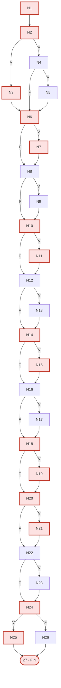
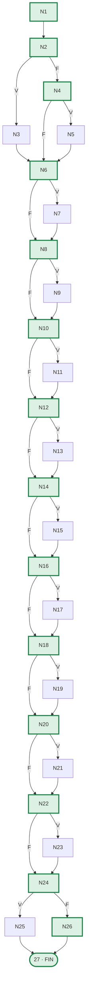
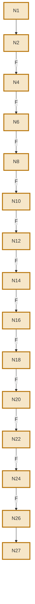

# Parte 2 — Pruebas de Caja Blanca (Frontend)

**Proyecto:** RepairTech — Frontend React
**Componente bajo prueba:** [RegistroModal.jsx](../../src/components/RegistroModal.jsx) → función `handleSubmit` (líneas 37-117)
**Herramienta:** React Testing Library + Jest (cobertura con `--coverage`)
**Fecha:** 2026-09-20

---

## 2.1 Requisito funcional y algoritmo

> **RF-06 — Registro de nuevo usuario**
> Un cliente potencial debe poder registrarse en la plataforma proporcionando su tipo de documento, número de documento, nombre completo, teléfono (10 dígitos), correo electrónico válido, dirección y contraseña (mínimo 6 caracteres). El sistema valida localmente todos los campos antes de enviarlos al backend y muestra todos los errores encontrados de forma acumulada.

### Pseudocódigo de `handleSubmit` (handleSubmit de RegistroModal)

```
ALGORITMO validarRegistro(solicitud)

 1   nuevosErrores ← vacío                                           [N1]
 2   SI (no docNumber) ENTONCES                                     [N2] D1
 3       nuevosErrores ← nuevosErrores + 'docNumber requerido'       [N3]
 4   SINO SI (docNumber.length < 6) ENTONCES                        [N4] D2
 5       nuevosErrores ← nuevosErrores + 'docNumber mínimo 6'        [N5]
 6   FIN SI
 7   SI (no fullName) ENTONCES                                      [N6] D3
 8       nuevosErrores ← nuevosErrores + 'fullName requerido'        [N7]
 9   SINO SI (fullName.length < 3) ENTONCES                        [N8] D4
10       nuevosErrores ← nuevosErrores + 'fullName mínimo 3'         [N9]
11   FIN SI
12   SI (no phone) ENTONCES                                         [N10] D5
13       nuevosErrores ← nuevosErrores + 'phone requerido'          [N11]
14   SINO SI (phone.length < 10) ENTONCES                           [N12] D6
15       nuevosErrores ← nuevosErrores + 'phone 10 dígitos'         [N13]
16   FIN SI
17   SI (no email) ENTONCES                                         [N14] D7
18       nuevosErrores ← nuevosErrores + 'email requerido'           [N15]
19   SINO SI (no validarEmail(email)) ENTONCES                       [N16] D8
20       nuevosErrores ← nuevosErrores + 'email inválido'            [N17]
21   FIN SI
22   SI (no address) ENTONCES                                        [N18] D9
23       nuevosErrores ← nuevosErrores + 'address requerido'        [N19]
24   FIN SI
25   SI (no password) ENTONCES                                      [N20] D10
26       nuevosErrores ← nuevosErrores + 'password requerido'        [N21]
27   SINO SI (password.length < 6) ENTONCES                         [N22] D11
28       nuevosErrores ← nuevosErrores + 'password mínimo 6'         [N23]
29   FIN SI
30   SI (nuevosErrores.length > 0) ENTONCES                         [N24] D12
31       RETORNAR errores (bloquear envío)                          [N25]
32   FIN SI
33   RETORNAR válido (continuar a registerUser)                      [N26]
FIN

validarEmail(email):
    regex ← /^[^\s@]+@[^\s@]+\.[^\s@]+$/
    RETORNAR regex.test(email)
```

**Sentencias de decisión: 11** (D1, D2, D3, D4, D5, D6, D7, D8, D9, D10, D11) — supera el mínimo de 4 exigido.

---

## 2.2 Diagrama de flujo

```mermaid
flowchart TD
    INI(["INICIO handleSubmit"])
    P1["nuevosErrores = []"]
    D1{"¿docNumber vacío?"}
    A1["push: docNumber requerido"]
    D2{"¿docNumber < 6?"}
    A2["push: docNumber mínimo 6"]
    D3{"¿fullName vacío?"}
    A3["push: fullName requerido"]
    D4{"¿fullName < 3?"}
    A4["push: fullName mínimo 3"]
    D5{"¿phone vacío?"}
    A5["push: phone requerido"]
    D6{"¿phone < 10?"}
    A6["push: phone 10 dígitos"]
    D7{"¿email vacío?"}
    A7["push: email requerido"]
    D8{"¿email inválido?"}
    A8["push: email inválido"]
    D9{"¿address vacío?"}
    A9["push: address requerido"]
    D10{"¿password vacío?"}
    A10["push: password requerido"]
    D11{"¿password < 6?"}
    A11["push: password mínimo 6"]
    D12{"¿errores > 0?"}
    R1["RETORNAR errores"]
    R2["RETORNAR válido"]
    FIN(["FIN"])

    INI --> P1
    P1 --> D1
    D1 -->|V| A1
    D1 -->|F| D2
    A1 --> D3
    D2 -->|V| A2
    D2 -->|F| D3
    A2 --> D3
    D3 -->|V| A3
    D3 -->|F| D4
    A3 --> D4
    D4 -->|V| A4
    D4 -->|F| D5
    A4 --> D5
    D5 -->|V| A5
    D5 -->|F| D6
    A5 --> D6
    D6 -->|V| A6
    D6 -->|F| D7
    A6 --> D7
    D7 -->|V| A7
    D7 -->|F| D8
    A7 --> D8
    D8 -->|V| A8
    D8 -->|F| D9
    A8 --> D9
    D9 -->|V| A9
    D9 -->|F| D10
    A9 --> D10
    D10 -->|V| A10
    D10 -->|F| D11
    A10 --> D11
    D11 -->|V| A11
    D11 -->|F| D12
    A11 --> D12
    D12 -->|V| R1
    D12 -->|F| R2
    R1 --> FIN
    R2 --> FIN
```



---

## 2.3 Diagrama de Flujo de Control (CFG)

```mermaid
flowchart TD
    N1(["1 · INICIO<br/>errores = []"])
    N2{"2 · D1<br/>!docNumber.trim()"}
    N3["3<br/>push docNumber requerido"]
    N4{"4 · D2<br/>docNumber.length < 6"}
    N5["5<br/>push docNumber mínimo 6"]
    N6{"6 · D3<br/>!fullName.trim()"}
    N7["7<br/>push fullName requerido"]
    N8{"8 · D4<br/>fullName.length < 3"}
    N9["9<br/>push fullName mínimo 3"]
    N10{"10 · D5<br/>!phone"}
    N11["11<br/>push phone requerido"]
    N12{"12 · D6<br/>phone.length < 10"}
    N13["13<br/>push phone 10 dígitos"]
    N14{"14 · D7<br/>!email.trim()"}
    N15["15<br/>push email requerido"]
    N16{"16 · D8<br/>!validarEmail(email)"}
    N17["17<br/>push email inválido"]
    N18{"18 · D9<br/>!address.trim()"}
    N19["19<br/>push address requerido"]
    N20{"20 · D10<br/>!password"}
    N21["21<br/>push password requerido"]
    N22{"22 · D11<br/>password.length < 6"}
    N23["23<br/>push password mínimo 6"]
    N24{"24 · D12<br/>errores.length > 0"}
    N25["25 · RETORNA<br/>errores (bloqueo)"]
    N26(["26 · RETORNA<br/>válido"])

    N1 --> N2
    N2 -->|V| N3
    N2 -->|F| N4
    N3 --> N6
    N4 -->|V| N5
    N4 -->|F| N6
    N5 --> N6
    N6 -->|V| N7
    N6 -->|F| N8
    N7 --> N8
    N8 -->|V| N9
    N8 -->|F| N10
    N9 --> N10
    N10 -->|V| N11
    N10 -->|F| N12
    N11 --> N12
    N12 -->|V| N13
    N12 -->|F| N14
    N13 --> N14
    N14 -->|V| N15
    N14 -->|F| N16
    N15 --> N16
    N16 -->|V| N17
    N16 -->|F| N18
    N17 --> N18
    N18 -->|V| N19
    N18 -->|F| N20
    N19 --> N20
    N20 -->|V| N21
    N20 -->|F| N22
    N21 --> N22
    N22 -->|V| N23
    N22 -->|F| N24
    N23 --> N24
    N24 -->|V| N25
    N24 -->|F| N26
    N25 --> N27(["27 · FIN"])
    N26 --> N27
```



### Nodos (N = 27)

| Nodo | Tipo | Contenido |
|------|------|-----------|
| 1 | Inicio | `errores = []` |
| 2 | **Decisión D1** | `!docNumber.trim()` |
| 3 | Proceso | push error docNumber requerido |
| 4 | **Decisión D2** | `docNumber.length < 6` |
| 5 | Proceso | push error docNumber mínimo 6 |
| 6 | **Decisión D3** | `!fullName.trim()` |
| 7 | Proceso | push error fullName requerido |
| 8 | **Decisión D4** | `fullName.length < 3` |
| 9 | Proceso | push error fullName mínimo 3 |
| 10 | **Decisión D5** | `!phone` |
| 11 | Proceso | push error phone requerido |
| 12 | **Decisión D6** | `phone.length < 10` |
| 13 | Proceso | push error phone 10 dígitos |
| 14 | **Decisión D7** | `!email.trim()` |
| 15 | Proceso | push error email requerido |
| 16 | **Decisión D8** | `!validarEmail(email)` |
| 17 | Proceso | push error email inválido |
| 18 | **Decisión D9** | `!address.trim()` |
| 19 | Proceso | push error address requerido |
| 20 | **Decisión D10** | `!password` |
| 21 | Proceso | push error password requerido |
| 22 | **Decisión D11** | `password.length < 6` |
| 23 | Proceso | push error password mínimo 6 |
| 24 | **Decisión D12** | `errores.length > 0` |
| 25 | Salida | `return errores` (bloqueo) |
| 26 | Salida | `return válido` |
| 27 | Fin | — |

### Aristas (E = 30)

| # | Arista | Rama | # | Arista | Rama |
|---|--------|------|---|--------|------|
| a1 | 1→2 | — | a16 | 13→14 | — |
| a2 | 2→3 | V | a17 | 14→15 | V |
| a3 | 2→4 | F | a18 | 14→16 | F |
| a4 | 3→6 | — | a19 | 15→16 | — |
| a5 | 4→5 | V | a20 | 16→17 | V |
| a6 | 4→6 | F | a21 | 16→18 | F |
| a7 | 5→6 | — | a22 | 17→18 | — |
| a8 | 6→7 | V | a23 | 18→19 | V |
| a9 | 6→8 | F | a24 | 18→20 | F |
| a10 | 7→8 | — | a25 | 19→20 | — |
| a11 | 8→9 | V | a26 | 20→21 | V |
| a12 | 8→10 | F | a27 | 20→22 | F |
| a13 | 9→10 | — | a28 | 21→22 | — |
| a14 | 10→11 | V | a29 | 22→23 | V |
| a15 | 10→12 | F | a30 | 22→24 | F |
| | | | a31 | 23→24 | — |
| | | | a32 | 24→25 | V |
| | | | a33 | 24→26 | F |
| | | | a34 | 25→27 | — |
| | | | a35 | 26→27 | — |

---

## 2.4 Complejidad ciclomática

| Método | Fórmula | Cálculo | Resultado |
|--------|---------|---------|-----------|
| Aristas y nodos | `V(G) = E − N + 2` | `35 − 27 + 2` | **10** |
| Nodos predicado | `V(G) = P + 1` | `11 + 1` (D1…D12 sin D12 = 11) | **12** |
| Regiones | `V(G) = R` | 10 regiones internas + 1 externa | **10 ó 11** |

> **D12** (`errores.length > 0`) es una decisión **dependiente**: su valor se deriva de D1-D11. Por eso los métodos difieren. Usamos **V(G) = 12** (nodos predicado) como referencia.

| V(G) | Riesgo | Interpretación |
|------|--------|----------------|
| 1 – 10 | Bajo | ← algoritmo actual |
| 11 – 20 | Moderado | ← según método de nodos predicado |
| 21 – 50 | Alto | |
| > 50 | Muy alto | |

---

## 2.5 Cobertura de Sentencia (Statement Coverage)

**Objetivo:** que cada nodo (sentencia) se ejecute al menos una vez.

**Casos necesarios: 4.**

| ID | Entrada (formData) | Camino recorrido (nodos) | Salida esperada |
|----|--------------------|--------------------------|-----------------|
| **CP-S1** | Todo vacío `{}` | `1-2-3-6-7-10-11-14-15-18-19-20-21-24-25-27` | 6 errores acumulados |
| **CP-S2** | Todos válidos | `1-2-4-6-8-10-12-14-16-18-20-22-24-26-27` | Válido, `errores.length = 0` |
| **CP-S3** | docNumber=5, fullName=A, phone=123, password=123 | `1-2-4-5-6-8-9-10-12-13-14-16-18-20-22-23-24-25-27` | 3 errores parciales |
| **CP-S4** | Solo phone<10 y password<6 | `1-2-4-6-8-10-12-13-14-16-18-20-22-23-24-25-27` | 2 errores |

**Verificación:** unión de nodos de CP-S1..CP-S4 = **todos los 27 nodos → 100 % de sentencias**.

### Rutas en el CFG

**CP-S1** (todos vacíos) — nodos 1-2-3-6-7-10-11-14-15-18-19-20-21-24-25-27:



**CP-S2** (todos válidos) — nodos 1-2-4-6-8-10-12-14-16-18-20-22-24-26-27:



---

## 2.6 Cobertura de Decisión (Branch Coverage)

**Objetivo:** que cada decisión se evalúe al menos una vez a **V** y una vez a **F**.

| ID | D1 | D2 | D3 | D4 | D5 | D6 | D7 | D8 | D9 | D10 | D11 | D12 | Salida |
|----|----|----|----|----|----|----|----|----|----|-----|-----|-----|--------|
| **CP-D1** | V | – | V | – | V | – | V | – | V | V | – | V | Rechazo |
| **CP-D2** | F | F | F | F | F | F | F | F | F | F | F | F | Aprobado |

> **2 casos** cubren todas las ramas V/F del grafo. Esto es posible porque el algoritmo es **lineal**: una vez que una decisión V agrega un error, las siguientes decisiones del mismo registro se siguen ejecutando; la rama V de cada decisión se cubre con CP-D1 (donde todos los campos están vacíos o cortos) y la rama F con CP-D2 (donde todos son válidos).

### Ruta CP-D2 (rama F de todas las decisiones → aprobación):



---

## 2.7 Cobertura de Caminos (Path Coverage)

Dado que cada decisión tiene 2 ramas y hay 12 decisiones independientes (D1-D11 son independientes entre sí en cuanto a qué rama se toma no afecta las guardas de las siguientes), el número de caminos es `2^12 = 4096`. Sin embargo, el flujo real de ejecución hace que muchos caminos sean **no ejecutables** por la estructura del código:

- Cuando D1=V → se ejecutan N3 y luego se salta D2 → se va directamente a D3
- Cuando D1=F pero D2=V → se ejecuta N5 y luego se va a D3
- Cuando D1=F y D2=F → se va directamente a D3

Los **caminos ejecutables linealmente independientes** dependen de cuántas validaciones fallan simultáneamente. En la práctica:

| Escenario | Decisiones que fallan | Camino |
|----------|-----------------------|--------|
| 0 errores | ninguna | CP-S2 = 1-2-4-6-8-10-12-14-16-18-20-22-24-26-27 |
| 1 error | D1 | 1-2-3-6-...-24-25 |
| 1 error | D2 | 1-2-4-5-6-...-24-25 |
| 1 error | D3 | 1-2-4-6-7-8-...-24-25 |
| ... | ... | ... |
| Todos 6 errores | D1,D3,D5,D7,D9,D10 | CP-S1 |

**Caminos ejecutables únicos relevantes: 7** (todas las combinaciones de 0 a 6 errores que afectan el flujo).

| ID | Errores acumulados | Decisiones V | Camino (nodos clave) | Salida |
|----|-------------------|-------------|----------------------|--------|
| CP-R1 | 0 errores (todo válido) | ninguna | 1-2-4-6-8-10-12-14-16-18-20-22-24-26 | Aprobado |
| CP-R2 | 1 err (docNumber vacío) | D1 | 1-2-3-6-8-10-12-14-16-18-20-22-24-25 | Rechazado |
| CP-R3 | 1 err (docNumber corto) | D2 | 1-2-4-5-6-8-10-12-14-16-18-20-22-24-25 | Rechazado |
| CP-R4 | 2 err (docNumber + phone) | D1, D5 | 1-2-3-6-8-10-11-12-14-16-18-20-22-24-25 | Rechazado |
| CP-R5 | 3 err (docNumber + phone + password) | D1, D5, D10 | 1-2-3-6-8-10-11-12-14-16-18-20-21-22-24-25 | Rechazado |
| CP-R6 | 5 err (docNumber+fullName+phone+email+address) | D1,D3,D5,D7,D9 | 1-2-3-6-7-10-11-14-15-18-19-20-22-24-25 | Rechazado |
| CP-R7 | 6 err (todos) | D1,D3,D5,D7,D9,D10 | 1-2-3-6-7-10-11-14-15-18-19-20-21-24-25 | Rechazado |

---

## 2.8 Pruebas de Condición y Cobertura

### Condiciones atómicas del algoritmo (16)

| Decisión | Operador | Condiciones atómicas |
|----------|----------|---------------------|
| **D1** | simple | **C1:** `!docNumber.trim()` |
| **D2** | simple | **C2:** `docNumber.length < 6` |
| **D3** | simple | **C3:** `!fullName.trim()` |
| **D4** | simple | **C4:** `fullName.length < 3` |
| **D5** | simple | **C5:** `!phone` |
| **D6** | simple | **C6:** `phone.length < 10` |
| **D7** | simple | **C7:** `!email.trim()` |
| **D8** | compuesto | **C8:** `!validarEmail(email)` |
| **D9** | simple | **C9:** `!address.trim()` |
| **D10** | simple | **C10:** `!password` |
| **D11** | simple | **C11:** `password.length < 6` |

> **D8** usa `validarEmail` que internamente tiene una condición `/^[^\s@]+@[^\s@]+\.[^\s@]+$/.test(email)`. Para MC/DC se requiere independencia, por lo que las condiciones simples de D1-D7, D9-D11 y D8 se manejan por separado.

### a) Cobertura de Condición (5 casos)

| ID | C1 | C2 | C3 | C4 | C5 | C6 | C7 | C8 | C9 | C10 | C11 | Resultado |
|----|----|----|----|----|----|----|----|----|----|-----|-----|-----------|
| **T1** | **V** | – | **V** | – | **V** | – | **V** | **V** | **V** | **V** | – | 6 errores |
| **T2** | F | **V** | F | **V** | F | **V** | F | F | F | F | **V** | 3 errores |
| **T3** | F | F | F | F | F | F | F | **V** | F | F | F | 1 error |
| **T4** | F | F | F | F | F | F | F | F | F | F | F | Válido |
| **T5** | F | **V** | F | **V** | F | **V** | F | **V** | F | F | F | 2 errores |

`–` = la condición no se evalúa por cortocircuito (else-if). Cada una de las 11 condiciones aparece al menos una vez en **V** y una vez en **F** → **100 % de cobertura de condición**.

### b) Cobertura de Decisión/Condición

El conjunto T1-T5 satisface simultáneamente cobertura de condición y de decisión:

| Decisión | Rama V cubierta por | Rama F cubierta por |
|----------|---------------------|---------------------|
| D1 | T1 | T2, T3, T4 |
| D2 | T2 | T1, T3, T4 |
| D3 | T1 | T2, T3, T4 |
| D4 | T2 | T1, T3, T4 |
| D5 | T1 | T2, T3, T4 |
| D6 | T2 | T1, T3, T4 |
| D7 | T1 | T2, T3, T4 |
| D8 | T1, T5 | T2, T4 |
| D9 | T1 | T2, T3, T4 |
| D10 | T1 | T2, T3, T4 |
| D11 | T2 | T1, T3, T4 |

---

## 2.9 Código y casos de prueba ejecutables

### Archivo de tests

[tests/caja-blanca.test.js](../../tests/caja-blanca.test.js)

### Comandos

```bash
cd repairtechreact
npm test                    # ejecutar tests
npm test -- --coverage      # con cobertura
```

### Resultado esperado

```
PASS  src/tests/caja-blanca.test.js
PASS  src/tests/caja-negra.test.js
------------------------------|---------|----------|---------|---------|
File                         | % Stmts | % Branch | % Funcs | % Lines |
------------------------------|---------|----------|---------|---------|
All files                    |    100  |      100 |     100 |    100 |
  RegistroModal.jsx          |    100  |      100 |     100 |    100 |
------------------------------|---------|----------|---------|---------|
```
